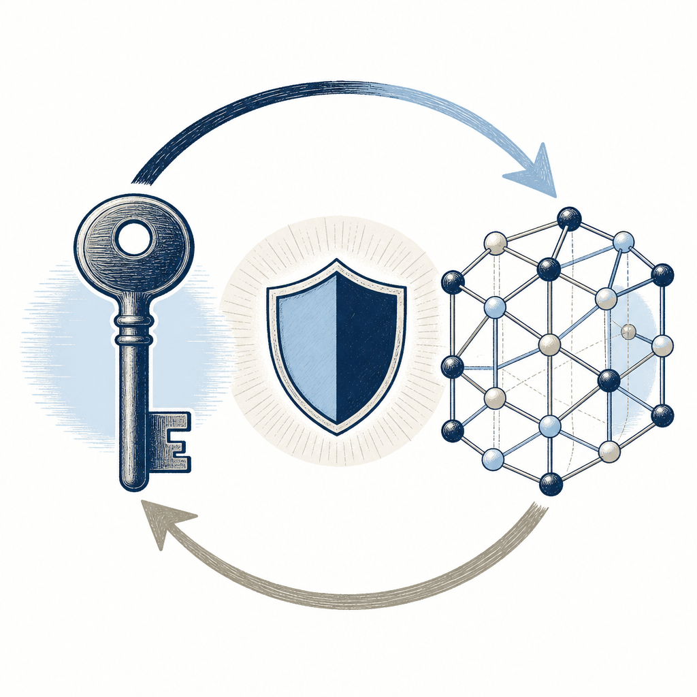

## 定義

以量子電腦也算不出來的數學基礎（lattice、code-based、hash-based、multivariate）取代傳統 RSA／ECC 的下一代加密技術。NIST 在 2024-08 正式發布第一批三個標準（Kyber、Dilithium、SPHINCS+）；同批選定的 Falcon 仍在制定 FIPS 206 中、尚未正式定案；全球大企業在做密碼遷移（Cryptographic Migration）。

## 關鍵面向

- **遷移範圍廣**：包括 HTTPS／VPN gateway／金融加密／企業 CA／程式碼簽章／TPM／HSM
- **遷移時間長**：Nicole Quinn 點名「遷移應用程式所需時間非常長」、慢一年就被動一年
- **NIST 標準現況（2026-11-02 查 NIST 官方頁更新）**：
  - 已定案（2024-08-13 發布）：FIPS 203 ML-KEM／Kyber、FIPS 204 ML-DSA／Dilithium、FIPS 205 SLH-DSA／SPHINCS+
  - 已選定、制定中：FIPS 206 FN-DSA／FALCON。NIST PQC 標準化頁（2026-10-27 更新）仍寫「in development」，未見正式草案發布
  - 已選定、制定中：HQC（2025-03 選為第五個演算法，NIST 當時預告約一年後出草案、2027 定案）；本卡原寫的「FIPS 207」編號**待驗證**，本次未在 NIST 官方來源查到
  - 已可用：SP 800-208 XMSS／LMS（stateful hash 簽章）
- **CNSA 2.0 國安適用**：203、204、SP 800-208 可用於美國國安；205、206 與 HQC 標準不可（原文寫「207」，編號待驗證，見上一條）
- **CNSA 2.0 時程**：2027-01-01 新採購須合規、2030-12-31 不支援設備分階段汰除、2033-12-31 強制使用
- **歐盟時程**：2026 First Steps、2030 高風險完成、2035 全面轉型
- **遷移不必等所有演算法定稿**：陳君明點出 203／204 已足夠、Kyber／Dilithium 工具鏈成熟
- **混合過渡**：Hybrid（傳統 + PQC 並列）保留兼容性、但增加營運複雜度
- **威脅時程壓縮**：Google 2025-05 把 1 週分解 RSA-2048 所需 noisy qubits 從 2,000 萬降到 100 萬、後續降到 50 萬
- **誤解澄清**：
  - Google 2029 是自家內外完成 PQC 遷移的目標、不是 Q-Day（媒體誤傳）
  - ECC-256 可能比 RSA-2048 更早被破（位元數較短）、加密貨幣 ECDSA 風險高
  - IBM 不是 PQC 標準唯一設計者、CRYSTALS 12 人團隊只有 2 位來自 IBM
- **生態瓶頸**：X.509 與協定整合多為 POC、FIPS 140-3 CMVP Level 3 HSM 尚未可用、供應鏈相依複雜
- **物件尺寸代價**：Kyber 公鑰 800–1568 bytes、SPHINCS+ 簽章可達 29,792 bytes（雜湊式簽章特別大）
- **重要 driver**：[[harvest-now-decrypt-later]] 攻擊讓 PQC 從「未來議題」變「現在議題」

## 應用場景

- Simon 工作場景：盤點公司哪些系統用 RSA／ECC、評估硬體（HSM／TPM）是否支援 PQC、列出遷移優先序；CNSA 2.0 時程當基準對齊台灣金管會／數位部即將出爐的規範；釐清 Q-Day 誤傳給董事會
- 一般場景：金融、政府、關鍵基礎設施；任何需保護長壽命資料的組織

## 相關概念

- [[harvest-now-decrypt-later]]：核心 driver
- [[critical-infrastructure]]：高優先序遷移對象
- [[mosca-theorem]]：x + y ≤ z 排序框架
- [[lattice-based-cryptography]]：Kyber／Dilithium 數學基礎
- [[crypto-agility]]：長線治理能力
- [[cbom]]：遷移 Day 1 工作

## 尚未解決的疑問

- 台灣數位發展部數位產業署／金管會 PQC 遷移時程實際公告時點
- 量子電腦真實成熟時點（Mosca 框架的 z）

## 來源（自動維護）

- [[2026-05-06-palo-alto-harvest-now-decrypt-later-cybersec]]
- [[2026-05-07-jimmy-chen-pqc-migration-cybersec]]
- NIST PQC 標準化頁 https://csrc.nist.gov/projects/post-quantum-cryptography/post-quantum-cryptography-standardization （2026-10-27 更新版，2026-11-02 查）
- NIST 新聞稿〈NIST Selects HQC as Fifth Algorithm for Post-Quantum Encryption〉https://www.nist.gov/news-events/news/2025/03/nist-selects-hqc-fifth-algorithm-post-quantum-encryption （2025-03）
